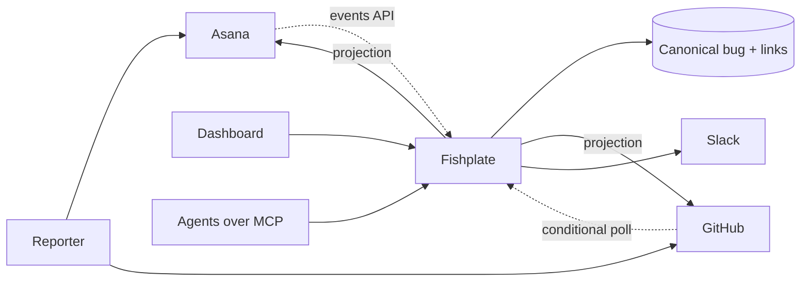

<h1 align="center">Fishplate</h1>

<strong>One canonical bug record across Asana, GitHub and Slack.</strong>

Fishplate joins two trackers that were never designed to meet. A bug lives in the system that owns
its fix, and everyone who needs to see it can, without being granted access to the repository it came
from. The name is the steel plate bolted across a rail joint: the seam stays, and the traffic runs
over it without noticing.

**Status: design phase.** No code yet. [`docs/DESIGN.md`](docs/DESIGN.md) is the authoritative
document and is written to be handed to an implementing agent.

## Objectives

1. **One state of record per field.** A field is written by one system and mirrored into the others.
2. **Visibility without widening access.** A bug in a repository someone cannot open should still be
   findable by the people who need it.
3. **Works behind NAT.** Polling and outbound sockets are the baseline; inbound webhooks are an
   accelerator. A homelab or a locked-down office can run a full instance.
4. **Nothing changes silently.** Every applied change is attributable, and every suppressed or
   rejected change stays visible instead of disappearing.
5. **People and agents share one record.** The MCP server works on the same canonical bug the
   dashboard shows, under its own audit identity.

Anything that does not serve one of these is scope.

## How it works

A report filed in one system creates or attaches to a canonical bug. Changes arrive from every
provider, are applied only when the source owns the field, and are projected to the others. Each
projection carries an origin marker and stores a hash of what was written, so the echo of our own
write is recognised and dropped instead of looping.

## What it does

- Links a GitHub issue to an Asana task without duplicating the conversation.
- Moves state one direction per field, and writes a conflict note when the other side tries.
- Shows every bug a person may see in one searchable list, with a timeline of what Fishplate did and
  what it refused to do.
- Posts one Slack message per bug and edits it, instead of announcing every event.
- Exposes bugs to agents over MCP, pinned to the 2026-07-28 revision of the protocol.

## What it does not do

- **Replace either tracker.** People keep filing and working where they already do.
- **Mirror both ways.** Two-way mirrors oscillate; this design has one direction per field.
- **Serve several companies from one install.** Single tenant by construction.
- **Store files.** Attachments stay where they were uploaded and are referenced by link.

## Questions that come up

**Why not one GitHub project for the whole org?** Project visibility follows repository visibility.
GitHub's documentation is explicit that only people with access to a private repository can see its
project items, so an org-wide board cannot exist under per-repository access.

**Why is polling the baseline?** Inbound endpoints are the part most networks make hard. Polling and
Socket Mode work from a homelab, and webhooks can be added later without changing the model.

**Will it support Jira or Linear?** Not in this design. The connector interface has two verbs, read
changes and write a projection, and the roadmap stays inside those.

## Roadmap

| Phase | Deliverable |
|---|---|
| 0 | Binary, config, migrations, health endpoint, CI |
| 1 | Read one GitHub repository into canonical bugs |
| 2 | Links, Asana events polling, identity map |
| 3 | Write path: outbox, projections, loop guards, state machine |
| 4 | Dashboard: search, detail, create, disposition, GitHub OAuth |
| 5 | Slack notifications over Socket Mode |
| 6 | MCP read tools over stdio and HTTP |
| 7 | Helm chart, demo compose file, signed multi-arch image |

## Documentation

[`docs/DESIGN.md`](docs/DESIGN.md) covers the problem, the data model, synchronisation semantics, each
connector, the dashboard, the MCP surface, failure handling, security, operations, the test strategy,
and the four assumptions to verify before implementation begins.

## Contributing

The design is open for review through issues. Code contributions are not being taken until the four
assumptions in section 25 of the design document have been tested against the real APIs.

## Licence

Apache-2.0. See [`LICENSE`](LICENSE).
