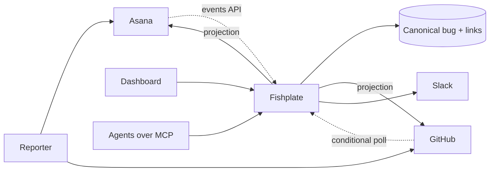

# Fishplate

Fishplate keeps one record per bug across Asana, GitHub and Slack. Each field has exactly one owning
system; Fishplate writes that value into the others, records who changed what, and stops two systems
from fighting over the same field.

The name is the plate bolted across a rail joint: the seam stays, the traffic does not notice it.

**Status: design phase.** No code yet. `docs/DESIGN.md` is written to be handed to an implementing
agent, and it is the authoritative document.

## Objectives

1. **One state of record per field.** A field is written by one system and mirrored into the others.
   Two systems maintaining the same value is the failure this exists to prevent.
2. **Visibility without widening access.** A bug in a repository someone cannot open should still be
   findable by the people who need it, without granting them the repository.
3. **Works behind NAT.** Polling and outbound sockets are the baseline; inbound webhooks are an
   accelerator. A homelab or a locked-down office can run a full instance.
4. **Nothing changes silently.** Every applied change is attributable, and every suppressed or
   rejected change is visible in the interface rather than lost.
5. **People and agents share one record.** The MCP server reads and writes the same canonical bug
   the dashboard shows, with its own audit identity.

A feature that does not serve one of these is scope, not progress.

## How it works

A report filed in one system creates or attaches to a canonical bug. Changes flow in from all
providers, are applied only if the source owns the field, and are projected to the others. Comments
carry an origin marker, and each projection stores a hash of what was written, so the echo of our own
write is recognised and dropped instead of looping.

## What it does

- Links a GitHub issue to an Asana task without copying the conversation into both.
- Moves state in one direction per field, with a written conflict note when the other side tries.
- Shows every bug a person may see in one searchable list, with the timeline of what Fishplate did
  and what it refused to do.
- Notifies Slack once per bug, editing the existing message rather than posting a new one per event.
- Exposes bugs to agents over MCP, pinned to the 2026-07-28 revision of the protocol.

## What it does not do

- **Replace either tracker.** People keep filing and working where they already do.
- **Mirror both ways.** Two-way mirrors oscillate; the design has one direction per field.
- **Serve several companies from one install.** Single tenant by construction.
- **Store files.** Attachments stay where they were uploaded and are referenced by link.

## Roadmap

| Phase | Deliverable |
|---|---|
| 0 | Binary, config, migrations, health endpoint, CI |
| 1 | Read one GitHub repository into canonical bugs |
| 2 | Links, Asana events polling, identity map |
| 3 | Write path: outbox, projections, loop guards, state machine |
| 4 | Dashboard: search, detail, create, disposition, GitHub OAuth |
| 5 | Slack notifications over Socket Mode |
| 6 | MCP read tools over stdio and HTTP |
| 7 | Helm chart, demo compose file, signed multi-arch image |

## Documentation

- [`docs/DESIGN.md`](docs/DESIGN.md) covers the problem, the data model, synchronisation semantics,
  each connector, the dashboard, the MCP surface, failure handling, security, operations, the test
  strategy and the four assumptions to verify before implementation starts.

## Contributing

The design is open for review through issues. Code contributions are not being taken until the
four assumptions in section 25 of the design document have been tested against the real APIs.

## Licence

Apache-2.0. See [`LICENSE`](LICENSE).
