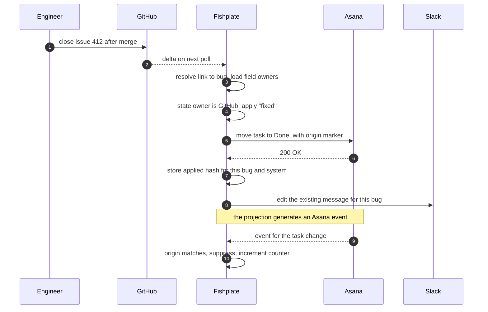
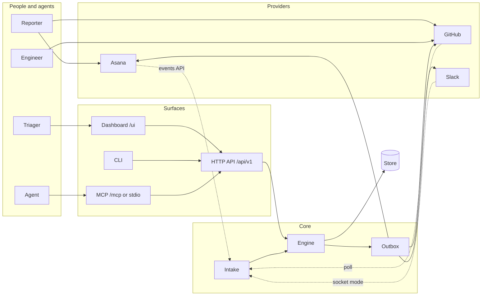
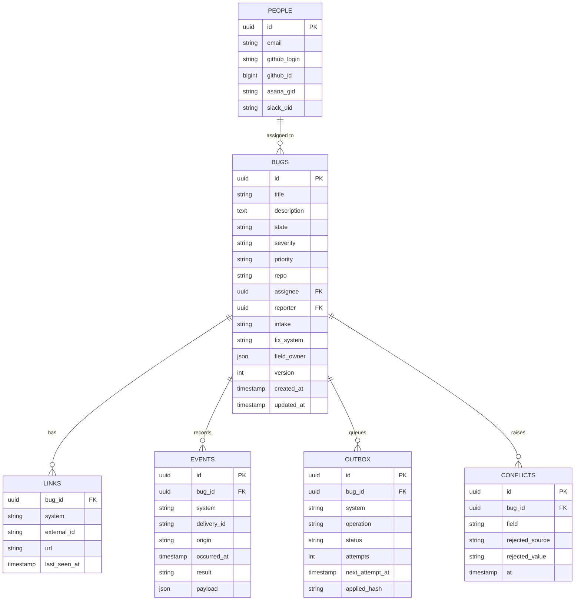
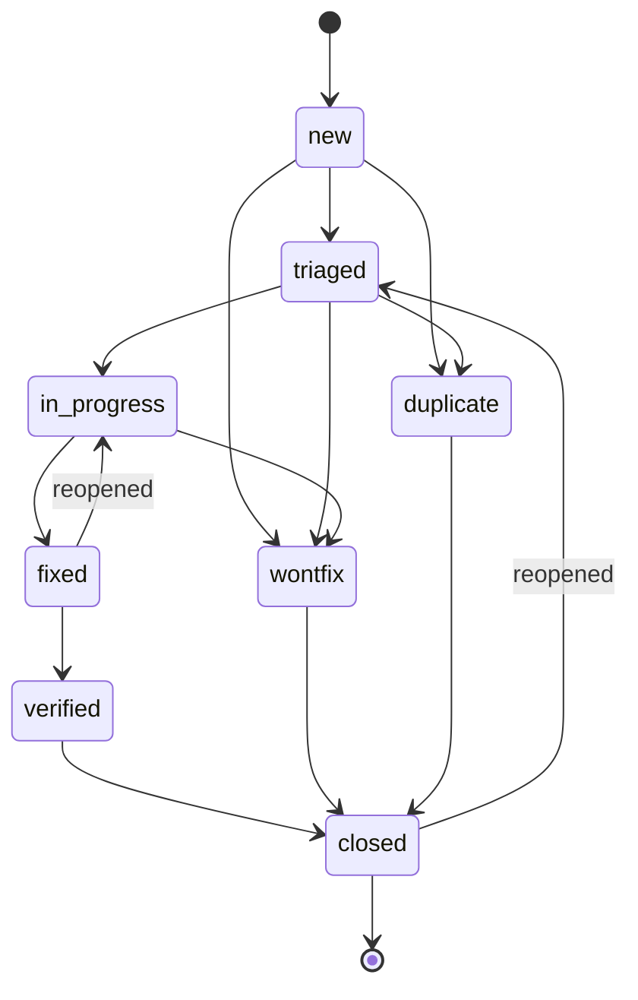
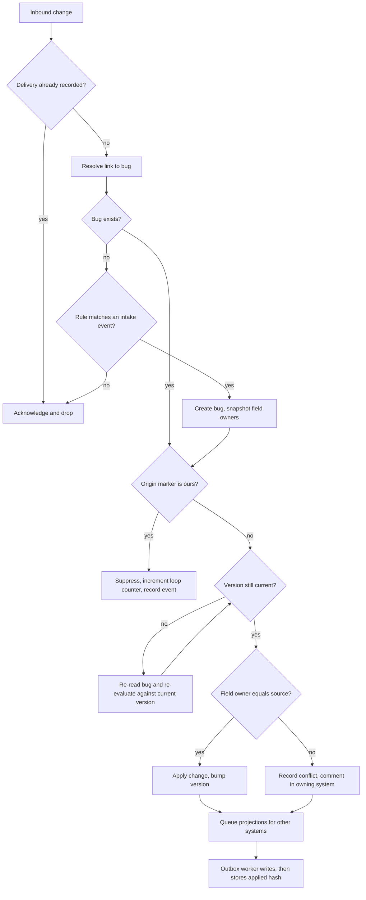

# Fishplate

**Design document**
Version 0.3 · 2026-11-12 · pre-implementation. Nothing here is built yet.

Every provider behaviour below links to the vendor documentation it came from. Where a statement is
this document's own inference rather than documented behaviour, the text says so, and section 25
lists the assumptions that would break the design if they turn out to be wrong.

Fishplate keeps one record per bug across Asana, GitHub and Slack. Each field has exactly one owning
system; Fishplate writes that value into the others and records who changed what. It runs as one
container, needs no inbound network access, and serves an MCP endpoint so agents work from the same
record as people.

The name is the plate bolted across a rail joint. The seam stays; the traffic does not notice it.

---

## 1. The problem

A company runs Asana company-wide and GitHub for code across many repositories, with access granted
per person. Most engineers can open a handful of repositories.

GitHub ties issue visibility to repository permission, and projects do not change that:

> Only people with access to a private repository will be able to view project items from that
> private repository.
>
> Source: [Managing visibility of your projects](https://docs.github.com/en/issues/planning-and-tracking-with-projects/managing-your-project/managing-visibility-of-your-projects)

An issue in a repository someone cannot open is invisible to them, whatever board it appears on.

Bug reports that are not about code have no natural home in a repository either: hardware failures,
production problems, supplier defects, test-equipment issues, customer reports.

The common workaround is to file the bug in both systems. Within a quarter the two records disagree,
and resolving the disagreement costs more attention than the bug did.

## 2. What Fishplate does

- Keeps a canonical bug record plus a link to each system's copy.
- Projects state between systems according to a declared owner per field.
- Refuses a write to a field another system owns, and says which system owns it.
- Shows every bug a person is allowed to see in one searchable list, without widening GitHub access.
- Notifies Slack once per bug rather than once per event.
- Exposes the same records to agents over MCP.

What it does not do, with the reason attached:

- **Replace either tracker.** People keep filing and working where they already do. Fishplate owns
  the link and the canonical copy, not a queue.
- **Mirror both ways.** Two-way mirrors oscillate. Section 10 describes the one-way projection and
  the guards that keep it stable.
- **Serve several companies from one deployment.** Single tenant; a shared deployment would need a
  tenancy model this design does not have.
- **Store files.** Attachments stay where they were uploaded and are referenced by link.

## 3. Scope

### v0.1

- GitHub Issues to Asana tasks, with a configurable project per repository or one shared project.
- Canonical bug record with the state machine in section 9.
- Field ownership, loop guards, outbox with retry, audit log.
- Slack notifications: one message per bug, edited in place.
- Web dashboard: search, view, create, edit, disposition, and admin for rules, connectors and people.
- MCP server, read-only.
- SQLite single instance, Docker image, Helm chart, Apache-2.0.

### Later

- Webhook intake for all three providers (v0.2). The polling path stays supported forever.
- Mutating MCP tools (v0.3).
- Duplicate suggestions, severity roll-ups, per-team routing, Slack thread mirroring, board views.

## 4. Design targets

Targets for the reference deployment, not limits of the design.

| Dimension | Target |
|---|---|
| Users | 50 named, 25 concurrent dashboard sessions |
| Bugs | 10,000 open and closed |
| Events retained | 200,000 |
| Inbound change rate | 500 per hour at peak |
| Outbox latency | p95 under 60 seconds |
| Dashboard search | p95 under 300 ms at 10,000 bugs |
| Footprint | 1 vCPU, 512 MiB RSS typical, 2 GiB limit |
| Recovery | rebuild links from providers in under 30 minutes at 10,000 bugs |

The rate limits in section 13 are the binding constraint on most of these, which is why section 16
gives the reconciler an explicit request budget rather than a timer.

## 5. Vocabulary

| Term | Meaning |
|---|---|
| **Bug** | The canonical record. Identified by a UUID that never changes. |
| **Link** | A mapping from a bug to an object in a provider, for example `github:issue:412`. |
| **Intake** | The system where a bug was first reported. One per bug. |
| **Fix system** | The system that owns state for that bug. Chosen at creation. |
| **Field owner** | The system permitted to write a given field on a given bug. |
| **Projection** | A write Fishplate makes into a system that does not own the field. |
| **Change** | A normalized description of something that happened in a provider. |
| **Delivery** | One webhook POST or one poll batch. Deduplicated by provider id. |

## 6. How a change travels



The projection carries a marker so the echo can be identified, and the echo still arrives. The
marker prevents a loop; it does not prevent the event. If a provider strips the marker, the
applied-hash check catches what the marker would have caught.

## 7. Components



One image, two entrypoints. `fishplate serve` runs intake, engine, outbox, dashboard, API and the
HTTP MCP endpoint. `fishplate mcp` runs the stdio MCP server for a local agent, reading through the
same API so permissions are implemented once.

Nothing requires a message broker. A single tenant at these volumes does not need Redis, and an
outbox table with `status`, `attempts` and `next_attempt_at` gives durability, backoff and a query
interface. If a deployment outgrows it, the outbox interface moves to a real queue without touching
the engine.

**Scheduling.** One polling goroutine per connector, a delivery worker per provider (not a shared
pool; see the pacing rule in section 13.1), and a reconciler. The reconciler is budgeted, not
timed: it may spend at most 40% of each provider's request allowance, and it works through bugs in
`last_seen_at` order so a bug that has just been checked is not checked again before a stale one.

## 8. Data model



Invariants the store enforces rather than documents:

- `LINKS` has a unique index on `(system, external_id)`. One provider object belongs to one bug.
- `EVENTS` has a unique index on `(system, delivery_id)`. Redelivery is a no-op. Poll batches use a
  synthetic delivery id derived from the cursor and batch hash.
- `BUGS.version` increments on every applied change. Writers pass the version they read; a mismatch
  re-reads instead of overwriting.
- `field_owner` is copied onto the bug at creation and travels with it. Changing the config does not
  retroactively change who owns an existing bug's field.
- `OUTBOX` rows are never deleted before their result is recorded. Completed rows are pruned after
  30 days.

Retention: events 90 days, outbox 30 days, conflicts 12 months, audit 24 months. A nightly job does
the pruning and records what it removed.

## 9. Bug states



Rules enforced in one function, used by every writer including the dashboard and MCP:

- `wontfix` requires a reason of at least ten characters.
- `duplicate` requires `duplicate_of`, which must be an existing bug id and not itself.
- `closed` is reachable only from `verified`, `wontfix` or `duplicate`.
- Reopening a closed bug returns it to `triaged`, because triage decides whether the original fix was
  wrong or the report was wrong.
- A transition that is not in the diagram is rejected with the list of allowed next states.

### 9.1 Provider mapping

GitHub issues carry both `state` and `state_reason`. The
[update an issue endpoint](https://docs.github.com/en/rest/issues/issues#update-an-issue) accepts
`state_reason` values `completed`, `not_planned`, `duplicate` and `reopened`, and accepts
`duplicate_issue_id` when the reason is `duplicate`. That covers every canonical terminal state
without a label convention, which an earlier draft of this document got wrong.

| Canonical | GitHub | Asana |
|---|---|---|
| `new` | open, no `triaged` label | task in New |
| `triaged` | `triaged` label | task in Triage |
| `in_progress` | `in progress` label, or an open linked PR | task in Doing |
| `fixed` | closed, `state_reason=completed` | task in Done, `fixed` custom field |
| `verified` | `verified` label | task in Verified |
| `wontfix` | closed, `state_reason=not_planned` | task completed, `resolution=wontfix` |
| `duplicate` | closed, `state_reason=duplicate`, `duplicate_issue_id` set | task completed, `resolution=duplicate` |

`state_reason=reopened` maps to `triaged`. Reading state back requires the labels on every list
call, so the connector requests them explicitly rather than relying on defaults.

## 10. Applying a change



### 10.1 Ownership

Ownership is configuration per field, copied to the bug at creation:

```yaml
fields:
  title:       { owner: intake }
  description: { owner: intake }
  severity:    { owner: asana }
  priority:    { owner: asana }
  repo:        { owner: asana }
  state:       { owner: fix }
  assignee:    { owner: fix }
```

`owner: fix` resolves to the bug's `fix_system`. A bug with a repository gets GitHub; a bug without
one gets Asana. A rule can override this at creation.

The non-owning copy carries a line at the top of its description: `Tracked by Fishplate. State is
managed in GitHub.` People stop editing the wrong copy when the wrong copy says so.

### 10.2 Loop guards

Three checks, each covering a different failure:

1. **Origin marker.** Comments and descriptions carry a marker with the outbox row id:
   `<!-- fishplate:origin=7c2f… -->` for GitHub, an appended `[fishplate:7c2f…]` line for Asana
   stories, and Slack message [metadata](https://docs.slack.dev/messaging/message-metadata/) with
   `event_type` `fishplate_origin` and the row id in `event_payload`. An inbound change containing a
   known id is suppressed.
2. **Applied hash.** After a projection, store `sha256` of the normalized fields written for that
   `(bug, system)`. An inbound change whose resulting normalized state hashes to the same value
   produces no projection. This is the guard that survives a provider stripping the marker.
3. **Version check.** Every write is conditional on the version read. A stale computation is
   re-evaluated, not applied.

A fourth failure is not covered by any of those: the process dies between sending a write and
recording its result. None of these providers offers an idempotency key, so a retry may duplicate.
The outbox worker reads the object back before retrying. If the external object already matches what
was sent, the row is marked done; if it does not, the write is repeated.

### 10.3 Ordering

Changes are applied in `occurred_at` order per bug, with ties broken by delivery id. Providers
deliver out of order under retry, and a `closed` arriving before the `opened` it refers to produces a
reopened ticket the next morning. Out-of-order changes younger than five minutes are held briefly in
a per-bug queue; older ones are applied against current version and reconciled by the next pass.

### 10.4 Conflict policy

For scalar fields the owner wins and the other side is told. There is no merge and no last-writer
wins between two systems. Comments and labels are additive, so both sides may contribute; labels
whose prefix belongs to a system are still written only by that system.

Conflict comments are deduplicated per `(bug, field, source)` for one hour. Without that, someone who
edits a title five times in the wrong tracker produces five identical notes and turns the feature
into spam.

Ownership can be changed deliberately with `fishplate bug set-owner <id> <field> <system>`, which
writes an audit row and is available to admins in the dashboard. Teams reorganise, and the
alternative to a supported takeover is people disabling the bridge.

### 10.5 Where this design is weakest

Written down because a design that cannot name its weak points has not been tested.

- **Field ownership is rigid, and rigidity is the point.** A team that edits both copies will see
  conflict notes and may conclude the bridge is broken. The mitigation is the description banner and
  a takeover command, not a softer rule. If the company will not accept one-owner-per-field, the
  correct answer is not this product.
- **Free-text bodies drift.** Title and description are owned by the intake system, so an edit made
  elsewhere is rejected. That is defensible for a bug report and irritating for a living description.
  A future version could mirror body edits as appended notes instead of refusing them.
- **A third place to look.** The dashboard can become a habit, which partly defeats the goal of
  leaving people in their tools. The design keeps the dashboard read-mostly in practice by offering
  no queue, no inbox workflow and no notifications of its own.
- **Polling is the opposite of what GitHub recommends.** Their
  [best practices](https://docs.github.com/en/rest/using-the-rest-api/best-practices-for-using-the-rest-api)
  open with "avoid polling" and recommend webhooks. This design accepts the recommendation and
  violates it deliberately, because an install behind NAT cannot receive webhooks at all, and a
  product that only works with a public endpoint is not deployable where this one starts. Webhooks
  become the fast path in v0.2 without removing polling.
- **Identity mapping is the likeliest thing to break in year two.** Handles change, people leave,
  and provider email visibility differs. Section 11 treats it as a product surface rather than a
  migration.

## 11. People

| Column | Source |
|---|---|
| `email` | canonical join key, lowercased |
| `github_id` | numeric id, stable across renames |
| `github_login` | display and admin lists |
| `asana_gid` | Asana user gid |
| `slack_uid` | Slack user id |

Resolution order: exact email, then a provider id match, then the alias table in config, then
`unmapped`. Unmapped is a real state, not an error: the bug keeps the provider's display name, the
dashboard shows it as unmapped, and `fishplate people unmapped` lists who needs fixing.

**GitHub email is the hard part.** A user whose email is private does not expose it through the
public user object, so an email join built only from API reads will fail for exactly the people who
care about privacy. The design gets the address from the person themselves: at dashboard login, the
user-to-server token calls `GET /user/emails`, which is available to an app holding the
[Email addresses permission](https://docs.github.com/en/rest/authentication/permissions-required-for-github-apps),
and the verified primary address is written to the map. Accounts that never log in stay unmapped
until an admin resolves them. That is a deliberate trade: no silent guessing from a noreply address.

Slack needs `users:read.email` in addition to `users:read` to return addresses from `users.list`;
without it, the Slack column of the map fills from logins only.

Matching keys on numeric ids matters. GitHub logins and Asana emails both change.

A `people sync` command refreshes the map from all three providers. It is safe to run on a schedule.

## 12. Rules

Rules are YAML, validated at startup against a JSON Schema, and rejected with a line-numbered error.
They never contain credentials; secrets come from the environment.

```yaml
version: 1
defaults:
  severity: s3
  intake: asana

people:
  match: email
  overrides:
    - email: "<work address, exactly as it appears in Asana>"
      github: sam-example
      asana: "[REDACTED]"

connectors:
  github:
    app_id: 12345
    installation_id: 67890123
    repos: ["acme/firmware", "acme/tools"]
    poll_interval: 60s
  asana:
    workspace: "[REDACTED]"
    project: "[REDACTED]"
    poll_interval: 60s
  slack:
    channel: "C0123456789"
    mode: socket

rules:
  - name: asana-report-becomes-github-issue
    when:
      source: asana
      event: task.added
      match:
        project: "[REDACTED]"
        section: "New"
    do:
      - bug.create:
          from: task
      - github.create_issue:
          repo: "{{ task.custom_fields.repo }}"
          title: "{{ task.name }}"
          body: "{{ task.notes }}\n\n---\nReported in Asana: {{ task.permalink_url }}"
          labels: ["type/bug", "from/asana"]
      - link: { system: github, external_id: "{{ result.number }}" }
      - slack.post:
          text: "New bug <{{ result.html_url }}|{{ task.name }}> from Asana"

  - name: github-issue-needs-business-visibility
    when:
      source: github
      event: issues.labeled
      match: { label: needs-business-visibility }
    do:
      - asana.create_task:
          name: "{{ issue.title }}"
          notes: "{{ issue.body }}\n\nGitHub: {{ issue.html_url }}"
      - link: { system: asana, external_id: "{{ result.gid }}" }
```

Semantics the implementation must hold to:

- `when.match` is exact match on normalized values; an absent key means any.
- Templates support path lookup and a `default` filter only. The context is `bug`, `task`, `issue`,
  `result` and `actor`.
- `bug.create` comes first; a `do` list that writes to a system without a link is rejected at
  validation time unless the write is the one that creates the link.
- Each rule names one intake event, so a bug has one intake system. Two rules creating a bug for the
  same provider object is a configuration error the validator catches by building a rule table and
  checking for overlapping intake matchers.
- Rule evaluation is deterministic and ordered. Two rules that could both fire on the same event are
  rejected.

## 13. Connectors

**First run.** Every connector supports a full crawl that pages the entire configured scope and
stores bugs and links before any cursor exists. The crawl is resumable, records its position, and
finishes before the incremental path starts. Without it a fresh install shows an empty dashboard and
the first incremental poll misses every pre-existing bug.

**Back-references make rebuild possible.** Every projection writes a pointer to the other system into
the provider object: the canonical bug UUID and the GitHub URL in an Asana task note, and a
`fishplate:bug=<uuid>` marker in the GitHub issue body. Without a back-reference, `rebuild` can only
recover links the database already knew, which is not a rebuild. With one, an operator can
reconstruct the table from the providers after losing the database, and the 30-minute recovery
target in section 4 becomes achievable.

### 13.1 GitHub

- **Auth:** a GitHub App, not a personal token. Installation tokens for server-to-server calls, with
  `issues: write`, `metadata: read`, `pull_requests: read`. The
  [permissions reference](https://docs.github.com/en/rest/authentication/permissions-required-for-github-apps)
  lists the endpoints each permission unlocks.
- **Read:** `GET /repos/{owner}/{repo}/issues?state=all&since=…` with the stored `ETag` in
  `If-None-Match`. `since` returns items last updated after the timestamp
  ([issues endpoint](https://docs.github.com/en/rest/issues/issues)). Conditional requests that
  return `304 Not Modified` do not count against the primary limit when the request is authenticated
  ([best practices](https://docs.github.com/en/rest/using-the-rest-api/best-practices-for-using-the-rest-api)).
  Respect `x-poll-interval` when GitHub sends it.
- **Write:** create, update and close issues, create comments. Closing with a reason uses
  `state_reason`, and a duplicate sets `duplicate_issue_id`.
- **Webhooks (v0.2):** `issues`, `issue_comment`, `pull_request`. Validate `X-Hub-Signature-256`,
  a SHA-256 HMAC of the raw body, before parsing
  ([validating webhook deliveries](https://docs.github.com/en/webhooks/using-webhooks/validating-webhook-deliveries)).
  Deduplicate on `X-GitHub-Delivery`; redeliveries carry the same id.
- **Rate limit:** an installation token gets a minimum of 5,000 requests per hour, plus 50 per
  repository above 20 and 50 per organization user above 20, capped at 12,500; 15,000 on GitHub
  Enterprise Cloud
  ([rate limits](https://docs.github.com/en/rest/using-the-rest-api/rate-limits-for-the-rest-api)).
  At 50 repositories polling once a minute that is 3,000 requests an hour before any page fetches,
  so the default interval for large installs must be two minutes, not one.
- **Pacing:** GitHub asks integrations to avoid concurrent requests and to pause at least one second
  between mutating requests to stay clear of secondary limits
  ([best practices](https://docs.github.com/en/rest/using-the-rest-api/best-practices-for-using-the-rest-api)).
  The outbox therefore runs one worker per provider with a one-second floor between writes and
  jitter, not a four-way pool.
- **Trap:** pull requests appear in the issues API and are identified by the `pull_request` key
  ([issues endpoint](https://docs.github.com/en/rest/issues/issues)). Anything with that key must be
  filtered out, or the bridge creates a bug for every PR. Linked PRs are read separately, from the
  timeline, to derive `in_progress`.

### 13.2 Asana

- **Auth:** a personal access token from a dedicated bot user that is a guest or limited-access
  member of the target project
  ([authentication](https://developers.asana.com/docs/authentication),
  [using bots](https://developers.asana.com/docs/using-bots.md)). Service accounts exist, but they
  are an Enterprise feature and grant access to all data in the workspace, including private
  projects, which is the opposite of least privilege for a bridge that needs one project.
- **Read:** the events API, `GET /events?resource=<project_gid>&sync_token=<token>`, with
  `opt_fields` set to the fields the sync uses. A subscription on a project includes changes to its
  tasks, subtasks and stories, because events bubble up
  ([events](https://developers.asana.com/docs/events)). `event.action` (added, changed, removed,
  deleted, undeleted) is distinct from `change.action`, and both matter.
- **Initial sync:** a request with no sync token returns **412 Precondition Failed**. The response
  carries an initial sync token in `next_page.sync`
  ([events](https://developers.asana.com/docs/events)).
- **Token lifetime:** sync tokens expire after 24 hours, and may expire sooner under load. A 412 at
  any point means re-crawl the project and start a new token
  ([events](https://developers.asana.com/docs/events)).
- **Delivery guarantee:** at most once, with a 24-hour retention window
  ([events](https://developers.asana.com/docs/events)). Events can be missing, which is why the
  reconciler and the nightly sweep exist.
- **Write:** create task, update task, set custom fields, move section, add story. Stories carry the
  origin marker.
- **Webhooks (optional, v0.2):** the handshake arrives as a POST carrying `X-Hook-Secret` while the
  create request is still open; echo the header and answer 200 or 204 synchronously or the
  subscription is never created. Verify `X-Hook-Signature`, a SHA-256 HMAC of the raw body, on every
  delivery. Answer within ten seconds; failures are retried for up to 24 hours, after which the
  webhook is deleted. Heartbeats arrive every eight hours, and a webhook that goes unanswered for 24
  hours is deleted
  ([webhooks](https://developers.asana.com/docs/webhooks-guide)). Treat a missing heartbeat as a
  liveness failure and recreate the subscription.
- **Rate limit:** 150 requests per minute on free domains, 1,500 on paid; search is capped at 60 per
  minute; concurrency is capped at 50 GETs and 15 writes in flight, counted separately. A 429
  carries `Retry-After` and still consumes quota, so retrying early makes the next window worse
  ([rate limits](https://developers.asana.com/docs/rate-limits)).
- **Unknown:** whether a custom-field change reports the custom field's gid in `change.field` or a
  generic name. The events documentation says only "the name of the field that has changed"
  ([events](https://developers.asana.com/docs/events)), and the design depends on knowing which
  custom field moved. This is the first thing to test, not assume.

### 13.3 Slack

- **Auth:** a bot token with `chat:write`, `channels:read`, `users:read` and `users:read.email`.
  Socket Mode additionally needs an app-level token with `connections:write`.
- **Socket Mode (default):** an outbound WebSocket with no public URL, built for apps behind a
  firewall. The WebSocket URL is not static; it is created at runtime by calling
  `apps.connections.open` and refreshed regularly, so the client must reconnect rather than cache it
  ([Socket Mode](https://docs.slack.dev/apis/events-api/using-socket-mode)).
- **Events API (optional):** verify `X-Slack-Signature`, an HMAC SHA-256 over `v0:{timestamp}:{body}`
  with the signing secret, and reject timestamps more than five minutes old
  ([verifying requests](https://docs.slack.dev/authentication/verifying-requests-from-slack)).
  Answer `url_verification` with the challenge and deduplicate on `event_id`.
- **Writes:** one message per bug, edited on state change, with comments as thread replies. Attach
  message [metadata](https://docs.slack.dev/messaging/message-metadata/) with the bug id so other
  apps can correlate without parsing text. Slack documents roughly one message per second per
  channel, plus a workspace-wide limit
  ([rate limits](https://docs.slack.dev/apis/web-api/rate-limits)).
- **Trap:** an app using Socket Mode cannot be listed in the public Slack Marketplace
  ([Socket Mode](https://docs.slack.dev/apis/events-api/using-socket-mode)). That is fine for a
  self-hosted deployment and rules out distribution as a marketplace app.

## 14. Web dashboard

The dashboard is not the primary interface. People keep working in GitHub and Asana. It is the only
place where the whole picture exists at once, and it covers the two jobs that have no home in either
provider: finding a bug across repositories you do not all have open, and dispositioning one without
opening a second tab.

It ships in v0.1 because a bridge whose behaviour cannot be inspected will not be trusted.

### 14.1 One writer

The dashboard is a client of the engine. Every action compiles to the same `Change` objects the
connectors produce and passes through the same ownership check, version check and audit. There is no
UI-only mutation path.

The interface has to be honest about that. Every editable field shows its owner and when it last
changed. Editing a field owned elsewhere opens a dialog that says so and offers either a conflict
note or an explicit ownership takeover, which is audited.

An edit to a field owned by Asana is sent to Asana with the bot token, not written straight into the
canonical record. The canonical value then changes when Asana's event comes back through the normal
path. That keeps one write path, keeps Asana's own history correct, and means the dashboard cannot
produce state the providers disagree with.

A dashboard that wrote the database directly would become a fourth system to reconcile.

### 14.2 Screens

**Inbox.** Saved views with counts: Untriaged, Mine, Recently changed, Conflicts, Unmapped people,
Connector errors. Each is a link to a filtered search; none is hard-coded.

**Search.** Full text over title, description and mirrored comments, with filters for state,
severity, priority, repo, assignee, labels, intake system, date range and "has conflicts". Queries
live in the URL so they can be shared and bookmarked. Result rows carry state, severity, repo,
assignee, age and the source of the last change.

**Bug detail.** The canonical record, the link rail with a jump-out link per system, and a timeline
that merges changes from every provider with the ones Fishplate made and the ones it suppressed.
Suppressed events are visible on purpose: they are the only evidence that the guards work.

Actions: edit title or description, transition state (only allowed transitions are offered), assign,
set severity or priority, add or remove a link, comment, and dispose.

**Disposition.** A dialog, not a dropdown. It asks for the terminal state, requires a reason for
`wontfix`, requires a duplicate target with search for `duplicate`, and previews what will happen in
each linked system. After confirming, it shows the outbox rows it created and their status.

**Create.** One form, with the fields the matched rule needs, showing which system will own the
result before submitting. Default intake comes from the rules; an override is recorded. Creation
always happens in the provider first, so there is never a bug that exists only in Fishplate.

**Admin.** Rules (validated with the same schema the server uses), connectors (status, last poll,
cursor age, rate-limit budget, re-auth), people (mapping table, unmapped queue, merge two
identities), and audit search. Connector secrets are write-only: they can be replaced, never read
back.

### 14.3 Access control

Login is GitHub OAuth, because access at the first deployment is granted per person. A team-based
model would be wrong about who can see what, and being wrong in the direction of showing someone a
repository they cannot open defeats the purpose.

The service is a GitHub App with user authorisation enabled. The flow uses `state` and PKCE, and the
callback exchanges the code for a user token
([user access tokens](https://docs.github.com/en/apps/creating-github-apps/authenticating-with-a-github-app/generating-a-user-access-token-for-a-github-app)).
The token is then used against `GET /user/installations/{installation_id}/repositories`, which
returns exactly the repositories that person may reach through this installation. A bug is visible
when its `repo` is in that set.

Two consequences belong in the README rather than in an operations note:

- **The App must be installed on every repository whose bugs should appear.** A user token can only
  reach the intersection of what the app was granted and what the user can see
  ([user access tokens](https://docs.github.com/en/apps/creating-github-apps/authenticating-with-a-github-app/generating-a-user-access-token-for-a-github-app)).
  A repository the app was not installed on has no dashboard presence for anyone.
- **User tokens expire after eight hours by default.** The design requests the `offline_access`
  scope so a refresh token is issued, stores it server-side alongside the session, and refreshes
  silently. Without that configuration a session dies mid-afternoon and users blame the tool.

Repository lists are cached per session for ten minutes and re-checked before any write. A 401 or
403 from the user token invalidates the cache immediately and downgrades the session, which is the
correct behaviour when someone is removed from a repository.

**Repo-less bugs** have no GitHub grant to consult. One setting decides: `ui.repo_less_visibility`
with values `everyone`, `triagers` or `admins`, defaulting to `everyone` because those bugs are the
reason non-engineers need the dashboard at all. Deployments that carry customer names should set it
to `triagers`.

**Roles** are configuration lists, not group claims: `admins: [logins]` and `triagers: [logins]`.
Everyone else is a viewer, who can read and comment. Triagers create, assign, set severity and
dispose. Admins additionally manage rules, connectors, people and field ownership. A local
break-glass admin exists for first boot and is disabled once a GitHub admin has logged in.

**Sessions.** The user token and refresh token live in the server-side session record, keyed by an
HttpOnly, Secure, SameSite=Lax cookie. Neither token is rendered, logged or placed in a URL. Logout
deletes the session. A revoked authorisation produces an empty repository list, never a permissive
fallback.

**Writes** are protected against CSRF with a per-session token on every form and a `SameSite=Lax`
cookie, and the OAuth callback validates `state` before exchanging the code.

### 14.4 Search

SQLite uses an [FTS5](https://www.sqlite.org/fts5.html) virtual table over title, description and
comment text, maintained by triggers, ranked with `bm25()`. Postgres uses a generated `tsvector`
column with a GIN index and
[`websearch_to_tsquery`](https://www.postgresql.org/docs/current/textsearch-controls.html). Both sit
behind one `Search(query, filters, page)` interface, so the dashboard, the API and MCP share
behaviour and tests. `fishplate search reindex` rebuilds while serving.

### 14.5 Implementation

Server-rendered Go templates with HTMX for partial updates, assets embedded with `embed.FS`, and
hand-written CSS. One binary serves `/ui`, so there is no second deploy and no CORS surface. The
dashboard is used occasionally by a handful of people; a React build would add a toolchain and a
release process for no gain, and forms keep working when JavaScript fails.

Live updates on the bug detail page use Server-Sent Events for state changes and outbox progress.
Every other page fetches on navigation. Nothing needs a WebSocket.

### 14.6 API

The UI calls `/api/v1`; the CLI and MCP call the same endpoints, which keeps one permissions
implementation instead of three.

| Method | Path | Purpose |
|---|---|---|
| GET | `/bugs` | list with filters, cursor pagination |
| POST | `/bugs` | create, honours `Idempotency-Key` |
| GET | `/bugs/{id}` | canonical record with links |
| PATCH | `/bugs/{id}` | edit fields, ownership enforced |
| POST | `/bugs/{id}/transition` | state change |
| POST | `/bugs/{id}/links` | add or remove a link |
| GET | `/bugs/{id}/events` | timeline, including suppressed |
| GET | `/search` | full text and filters |
| GET | `/rules`, `PUT /rules` | read and replace rules |
| GET | `/connectors` | status and cursors |
| GET | `/people` | mapping and unmapped |
| GET | `/audit` | audit search |

Pagination is cursor-based with a maximum page size of 100. Errors use
[RFC 9457](https://www.rfc-editor.org/rfc/rfc9457.html) `application/problem+json`. Breaking changes
get a new path version; the old one stays for one minor release.

### 14.7 Degradation

When a connector is down the dashboard stays readable and says so: a banner naming the connector and
its last successful sync, affected fields marked stale, and writes that need that connector disabled
with the reason. A read-only dashboard during an outage is useful. A dashboard that silently shows
yesterday's state as current is worse than no dashboard.

## 15. MCP server

Target the **2026-07-28** revision, whose
[changelog](https://modelcontextprotocol.io/specification/2026-07-28/changelog) removes the
`initialize` handshake and protocol-level sessions. Every request declares its protocol version and
client capabilities in `_meta` (`io.modelcontextprotocol/protocolVersion`,
`io.modelcontextprotocol/clientCapabilities`), and the server accepts or rejects each request
independently ([versioning](https://modelcontextprotocol.io/specification/versioning)).

Requirements that follow from that revision, all documented in the
[Streamable HTTP binding](https://modelcontextprotocol.io/specification/2026-07-28/basic/transports/streamable-http):

- Every POST carries `MCP-Protocol-Version`, `Mcp-Method` and `Mcp-Name`, and the version header
  must match the value in `_meta`. A request missing a required header is rejected.
- Servers MUST validate `Origin` on incoming connections to prevent DNS rebinding, and reject an
  invalid one.
- Every result carries `resultType`, either `complete` or `input_required`.
- `tools/list`, `resources/list` and reads carry `ttlMs` and `cacheScope`
  ([caching](https://modelcontextprotocol.io/specification/2026-07-28/server/utilities/caching)). A
  cacheable result is keyed by method plus the parameters that change it, and `cacheScope: private`
  forbids sharing it across authorization contexts.
- `tools/list` returns a deterministic order, so client caching and prompt caches stay useful.
- Change notifications use a single long-lived `subscriptions/listen` stream. Resumable SSE with
  `Last-Event-ID` is gone, so a broken stream means reissuing the request.
- `server/discover` is implemented even though clients may skip it
  ([discovery](https://modelcontextprotocol.io/specification/2026-07-28/server/discover)); it is the
  only way a client learns the supported versions in one call.
- Roots, sampling and logging are deprecated in this revision. New code should not use them.

Transports: `stdio` for a local agent, Streamable HTTP at `/mcp` when enabled. On stdio the server
writes nothing to stdout except protocol messages, and logs go to stderr.

### Tools, v0.1 (read-only)

| Tool | Arguments | Returns |
|---|---|---|
| `bug_search` | `query`, `state?`, `severity?`, `repo?`, `limit?` | summaries with links |
| `bug_get` | `id` | canonical record, links, recent events |
| `bug_status` | `id` | state, owner, last change, authoritative system |
| `bug_list` | `repo?`, `state?`, `updated_since?`, `cursor?` | page of summaries |
| `bug_links` | `id` | external objects with URLs |

### Tools, v0.3 (mutating, behind a config flag)

| Tool | Arguments |
|---|---|
| `bug_create` | `title`, `description`, `severity`, `repo?` |
| `bug_comment` | `id`, `text`, `systems?` |
| `bug_transition` | `id`, `state`, `reason?` |
| `bug_link` | `id`, `system`, `external_id` |

MCP calls are attributed to `agent:<client name>` in the audit log, never to a human. An agent's
action should never appear to be a person's.

Resources: `fishplate://bugs/{id}` returns the canonical record as JSON; `fishplate://rules` returns
the active configuration with secrets removed.

## 16. Failure handling

| Failure | Behaviour |
|---|---|
| Provider 5xx on write | Outbox backoff at 10s, 30s, 2m, 10m, 1h, 6h; dead-letter after eight attempts and alert. |
| Rate limited | Honour `Retry-After`; per-connector token bucket sized to the plan in use. For Asana, a 429 still spends quota, so back off harder than the header suggests. |
| Process dies after write, before recording | Read the external object; if it matches the intended write, mark done; otherwise retry. |
| Missed event or webhook | Reconciliation pass on a request budget; nightly full sweep covers Asana's 24-hour event window. |
| Out-of-order delivery | Per-bug ordering by `occurred_at`, five-minute hold window, re-evaluation against current version. |
| Duplicate delivery | Unique index on `(system, delivery_id)`; duplicates return 200 with no work. |
| Provider schema change | Contract tests against recorded payloads fail the build before production sees it. |
| Database lost | `fishplate rebuild --from github --from asana` reconstructs links from the back-references in section 13. |
| Sessions lost | Users log in again. Nothing durable lives in a session. |

**Reconciliation budget.** Ten thousand bugs re-read every fifteen minutes would need about 667
requests a minute, more than four times Asana's 150-per-minute free limit. The reconciler therefore
works to a budget: at most 60 Asana requests a minute and 120 GitHub requests a minute, oldest
`last_seen_at` first, cycling continuously. A full Asana sweep of 10,000 bugs at 60 a minute takes
under three hours, which is fine overnight and too slow for the fifteen-minute figure the earlier
draft claimed. Latency on the fast path comes from the events API and from incremental polling, not
from the reconciler.

## 17. Security

| Area | Control |
|---|---|
| Secrets | Environment or mounted file only. Never in the image, the repository or the rules file. |
| Webhook authenticity | Signature over raw bytes before parsing, constant-time comparison, timestamp window where the provider supplies one. |
| Replay | Delivery ids are unique across all time for webhooks; the events table is the replay defence. |
| Least privilege | GitHub App on named repos with three permissions; an Asana bot user limited to one project; a Slack bot in two channels. |
| SSRF | Outbound hosts are an allowlist of the three provider APIs. No user-supplied URL is fetched. |
| Dashboard sessions | HttpOnly, Secure, SameSite=Lax cookie; server-side token storage; OAuth `state` and PKCE. |
| CSRF | Per-session token on every state-changing form and API call from the browser. |
| XSS | Templates escape by default; no user HTML is rendered unescaped; CSP forbids inline script. |
| Audit | Actor, system, object, before and after hashes for every applied change. Append-only table. |
| PII | The people table holds email addresses. Documented in the README, pruned when a person is removed. |
| Public repository | Fixtures and demo configuration only. CI fails on a configured denylist of real names, domains and ids. |

The threat model that matters most is not an outside attacker. It is a misconfigured rule that
rewrites a thousand bugs, and the defence is the audit table, a dry-run mode on rule changes and the
outbox preview in the dashboard.

## 18. Operations

**Configuration precedence:** command-line flags, then `FISHPLATE_*` environment variables, then the
config file, then defaults. `fishplate config show --effective` prints the resolved result with
secrets redacted.

**Database.** SQLite in WAL mode, `busy_timeout` set, one writer. Postgres for anyone who needs
multiple replicas; the schema and queries are shared, migrations exist for both. The Helm chart
defaults to SQLite on a persistent volume.

**Backup.** Nightly `VACUUM INTO` for SQLite, `pg_dump` for Postgres, into a directory the operator
names. Restore is documented and tested by opening the copy with `PRAGMA integrity_check`.

**Upgrade.** Migrations are forward-only and run at startup under an advisory lock.
`fishplate migrate --dry-run` prints the plan; `--migrate-only` supports init containers. The binary
refuses to start if the schema is newer than the binary.

**Deployment.** Distroless image, multi-arch, non-root, read-only root filesystem, one binary and one
config file. On a single-node cluster the local-path provisioner typically budgets 32 GB per volume;
this database is megabytes, but the limit is written down so nobody is surprised.

No ingress is required for the reference deployment: Socket Mode for Slack, events API for Asana,
conditional polling for GitHub. That is what lets it start on a single node without waiting for a
certificate or a port forward.

**Health.** `/healthz` for the process, `/readyz` for database writability and connector
initialisation, `/metrics` for Prometheus.

**Config reload.** SIGHUP re-reads rules. Invalid rules are rejected and the previous set stays
active, with a log line naming the error.

## 19. Observability

Metrics:

- `fishplate_changes_total{source,result}` where result is applied, suppressed, conflict or error.
- `fishplate_outbox_lag_seconds` by system.
- `fishplate_provider_errors_total{provider,code}`.
- `fishplate_reconcile_drift_total` by system, counting values the reconciler had to repair.
- `fishplate_loop_suppressed_total` by system.
- `fishplate_ratelimit_remaining{provider}`.
- `fishplate_search_duration_seconds`.
- `fishplate_dashboard_actions_total{action,role}`.

`loop_suppressed_total` is the health signal for the whole design. A zero rate through a busy week
means the guards are untested, not that they are working; the echo test in section 20 exists to make
sure the counter moves.

Logs are JSON with `bug_id`, `source` and `delivery_id` on every line. Traces are optional at v0.1.

Suggested alerts: outbox lag above five minutes for fifteen minutes; any dead-letter row; reconcile
drift above ten per hour; a connector with no successful poll in three intervals; rate-limit
remaining under 20% for an hour.

## 20. Testing

- **Unit:** state machine transitions (including every rejected transition), ownership resolution,
  template evaluation, change normalization per provider.
- **Contract:** recorded payloads from all three providers, replayed through the connector. These
  catch schema drift, and they run in CI on every pull request.
- **Integration:** a fake provider that implements the endpoints the connectors use, including
  pagination, 304s, rate limiting and 5xx.
- **Echo test (release gate):** with two fake systems wired to each other, make a change that would
  loop, and assert that it settles after one projection and that `loop_suppressed_total` increments
  exactly once. A bridge that cannot pass this is not releasable.
- **Crash test:** kill the process between the provider write and the outbox update, then restart and
  assert the object is not duplicated.
- **Rate test:** run the pollers against a token bucket that mirrors Asana's 150-per-minute and 15
  concurrent writes, and assert no 429 storm and no dead letters.
- **Load:** the section 4 targets at five times the stated rate, for an hour.
- **Restore test:** back up, delete, restore, verify counts, and confirm the next poll applies cleanly.

## 21. Repository layout

```text
cmd/fishplate/            main and subcommands
internal/engine/          change application, ownership, state machine
internal/connectors/      github/ asana/ slack/, one package each, shared interface
internal/store/           sqlite and postgres, migrations, queries
internal/web/             handlers, templates, embedded assets, SSE
internal/mcp/             tools, resources, transports
internal/rules/           schema, validation, template evaluation
api/                      OpenAPI for /api/v1
deploy/helm/fishplate/    chart
docs/                     this design, connector notes, runbook
testdata/                 recorded provider payloads
```

The connector interface is narrow on purpose: read changes since a cursor, and apply a projection.
Anything that does not fit those two verbs belongs outside the connector.

## 22. Delivery plan

Each phase ends with something demonstrable. No phase starts before the previous one runs.

**Phase 0, skeleton.** Binary, config loading, SQLite migrations, `/healthz`, structured logs,
Dockerfile, CI, unit tests.
*Done when:* `docker run` answers health and `fishplate version` reports the build.

**Phase 1, read GitHub.** Poll one repository with ETags and store issues as bugs. No writes.
*Done when:* a real repository's issues appear as bugs, a second poll creates no duplicates, and the
connector reports 304s.

**Phase 2, links and Asana read.** Events API polling for one project, identity map from email, a
link rule that connects the two.
*Done when:* a task and its issue share one bug row, and every assignee resolves or is reported
unmapped.

**Phase 3, write path.** Outbox, projections, loop guards, comment mirroring, state machine.
*Done when:* closing an issue closes its task within a minute, a write to the wrong side produces a
conflict note instead of a fight, and the echo test passes.

**Phase 4, dashboard.** Search, detail, create, edit, disposition, conflicts, audit, GitHub OAuth,
`/api/v1`.
*Done when:* a triager finds an untriaged bug, assigns it and closes it as `wontfix` from the UI, both
providers agree, and a deliberately rejected edit appears in Conflicts with its reason.

**Phase 5, Slack.** Socket Mode notification, one edited message per bug.
*Done when:* a state change edits the existing message rather than posting a new one, and a socket
drop reconnects without duplicate messages.

**Phase 6, MCP.** stdio and HTTP, `server/discover`, caching fields, read tools.
*Done when:* an agent answers "what is broken in this repository" through MCP alone.

**Phase 7, release.** Helm chart, docs, compose demo with fixtures, Apache-2.0, signed multi-arch
image.
*Done when:* a stranger clones the repository and has the demo running in under ten minutes without
an account on any provider.

## 23. Decisions still open

| Decision | Proposed default | Why |
|---|---|---|
| Language | Go | One static binary, cheap concurrency for pollers, good MCP libraries, small container. |
| Licence | Apache-2.0 | Patent grant matters when a company publishes tooling it also uses commercially. |
| Database | SQLite default, Postgres supported | One writer covers the target; Postgres is there for anyone who needs replicas. |
| Slack transport | Socket Mode | No public endpoint, which is the constraint most self-hosted installs have. |
| Intake default | Asana | Reporters are usually outside the repository permission set. |
| Fix system default | GitHub when a repo is known, Asana otherwise | Hardware and production bugs have no issue to own their state. |
| Asana projects | One per deployment in v0.1 | Routing rules need a rule engine feature that is not in v0.1. |
| Comment mirroring | On, with marker; switch to disable | Silence in the other system looks like the bridge dropped the comment. |
| Attachments | Never mirrored | File storage is out of scope and duplicate uploads age badly. |
| Duplicate detection | Report only, human approves | Auto-merge of near-identical reports destroys evidence when it is wrong. |
| Dashboard stack | Go templates and HTMX | One artifact, no node toolchain, forms work without JavaScript. |
| Dashboard auth | GitHub OAuth with user-to-server tokens | Access is per person; a team model would be wrong about visibility. |
| Dashboard visibility | The user's own installation repository list, ten-minute cache | Matches GitHub exactly, including direct collaborator grants. |
| Repo-less bugs | `ui.repo_less_visibility: everyone` | They are the reason non-engineers use the dashboard. Change to triagers where customer data appears. |
| Live updates | SSE on the detail page only | One screen benefits; the rest polls on navigation. |

## 24. Risks

1. **Identity mapping rots.** People leave, handles change, shared mailboxes are reassigned.
   Mitigation: numeric ids, an explicit unmapped state, capture of verified addresses at login, and a
   dashboard view that makes the backlog visible.
2. **A loop guard fails in production.** Users see a fix reverted or a ticket reopened by the bridge
   and stop trusting it, and trust does not come back quickly. Mitigation: the echo test is a release
   gate, applied hashes are stored per projection, and suppressed events are visible in the UI.
3. **Provider drift.** Asana and Slack change without much notice. Mitigation: contract tests on
   recorded payloads and a startup check that warns when an endpoint shape changes.
4. **Scope creep into an integration platform.** The next request will be Jira, then Linear.
   Mitigation: the connector interface has two verbs, and the README says no.
5. **Adoption failure.** If triage happens in Slack threads, none of this matters. Mitigation: the
   Slack-to-bug rule in v0.3 may matter more than the sync engine, and it should be evaluated before
   the roadmap grows.

## 25. Prove these before building

Five assumptions carry weight. Each can be tested with an afternoon and a scratch token.

1. **Asana reports custom-field changes in a usable shape.** A custom-field change must appear as a
   `changed` event whose `change.field` identifies the field, and the initial 412 must return a
   usable sync token. The documentation describes `change.field` only as "the name of the field"
   ([events](https://developers.asana.com/docs/events)), so this is measured, not assumed. If custom
   fields do not surface, severity and repo mapping need a different source.
2. **GitHub's conditional requests are free and the budget fits.** A 304 must not consume the
   5,000-per-hour floor, and fifty repositories polling every minute must stay inside it once page
   fetches and writes are counted. Measure `x-ratelimit-remaining` across a day.
3. **The origin marker survives both providers.** Comment and story rendering must return the marker
   intact on read, and Slack must return message metadata unmodified. If either strips it, only the
   applied hash is load-bearing.
4. **A user-to-server token returns the right repository list.** Compare
   `GET /user/installations/{id}/repositories` against what a second account actually sees in
   GitHub, including a repository reached through a direct collaborator grant and one reached through
   a team. Per-person access is exactly the case a team model gets wrong.
5. **A bot user in Asana can do the job.** Confirm that a guest or limited-access bot user can move
   tasks between sections, set the custom fields the design uses, and post stories in the target
   project, without the org-wide reach of an Enterprise service account.

---

## References

Provider documentation, all fetched 2026-11-12:

**GitHub**
- [Managing visibility of your projects](https://docs.github.com/en/issues/planning-and-tracking-with-projects/managing-your-project/managing-visibility-of-your-projects): project items follow repository permissions.
- [REST API endpoints for issues](https://docs.github.com/en/rest/issues/issues): `since`, `state_reason`, pull requests in issue responses.
- [Rate limits for the REST API](https://docs.github.com/en/rest/using-the-rest-api/rate-limits-for-the-rest-api): installation token floor, scaling, cap.
- [Best practices for using the REST API](https://docs.github.com/en/rest/using-the-rest-api/best-practices-for-using-the-rest-api): conditional requests, pacing, avoiding concurrency.
- [Generating a user access token for a GitHub App](https://docs.github.com/en/apps/creating-github-apps/authenticating-with-a-github-app/generating-a-user-access-token-for-a-github-app): OAuth flow, PKCE, `offline_access`, eight-hour tokens, repository intersection.
- [Permissions required for GitHub Apps](https://docs.github.com/en/rest/authentication/permissions-required-for-github-apps): permission names and `GET /user/emails`.
- [Validating webhook deliveries](https://docs.github.com/en/webhooks/using-webhooks/validating-webhook-deliveries): `X-Hub-Signature-256`.

**Asana**
- [Events](https://developers.asana.com/docs/events): sync tokens, 412, 24-hour expiry, at-most-once delivery, bubbling.
- [Webhooks](https://developers.asana.com/docs/webhooks-guide): handshake, signature, ten-second window, eight-hour heartbeats, deletion.
- [Rate limits](https://developers.asana.com/docs/rate-limits): per-minute quotas, concurrency, search cap.
- [Authentication](https://developers.asana.com/docs/authentication): PATs, service accounts, attribution.
- [Using bots](https://developers.asana.com/docs/using-bots.md): bot accounts and scope restriction.

**Slack**
- [Rate limits](https://docs.slack.dev/apis/web-api/rate-limits): one message per second per channel.
- [Using Socket Mode](https://docs.slack.dev/apis/events-api/using-socket-mode): outbound WebSocket, `apps.connections.open`, Marketplace restriction.
- [Verifying requests from Slack](https://docs.slack.dev/authentication/verifying-requests-from-slack): signing secret, five-minute window.
- [Using message metadata](https://docs.slack.dev/messaging/message-metadata/): `metadata` parameter and `source.ref_id`.

**Model Context Protocol**
- [Specification 2026-07-28](https://modelcontextprotocol.io/specification/2026-07-28) and [changelog](https://modelcontextprotocol.io/specification/2026-07-28/changelog): stateless revision, sessions removed.
- [Versioning](https://modelcontextprotocol.io/specification/versioning): per-request version negotiation.
- [Streamable HTTP](https://modelcontextprotocol.io/specification/2026-07-28/basic/transports/streamable-http): required headers, `Origin` validation, no resumable SSE.
- [Discovery](https://modelcontextprotocol.io/specification/2026-07-28/server/discover): `server/discover`.
- [Caching](https://modelcontextprotocol.io/specification/2026-07-28/server/utilities/caching): `ttlMs`, `cacheScope`.

**Other**
- [SQLite FTS5](https://www.sqlite.org/fts5.html): full-text search virtual table.
- [PostgreSQL text search controls](https://www.postgresql.org/docs/current/textsearch-controls.html): `to_tsvector`, `tsquery`.
- [RFC 9457](https://www.rfc-editor.org/rfc/rfc9457.html): Problem Details for HTTP APIs.
